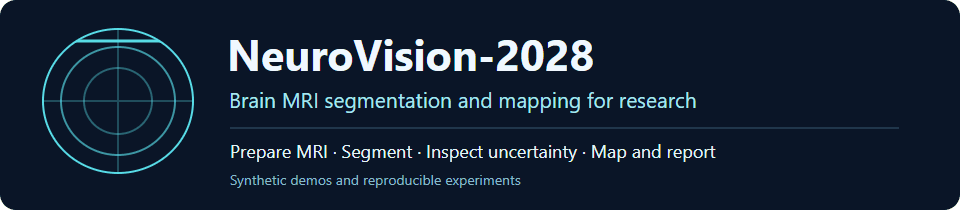
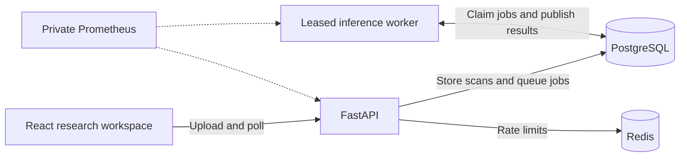
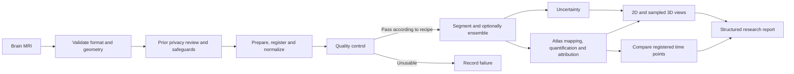
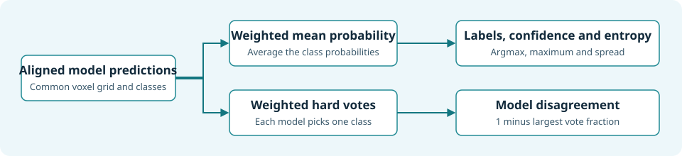
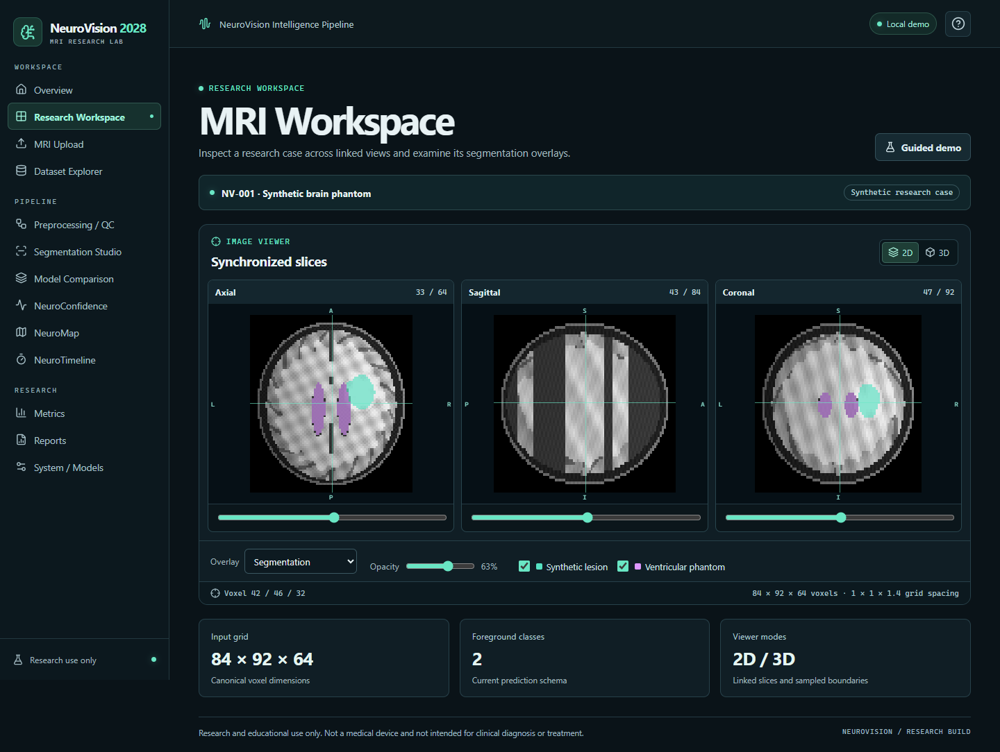
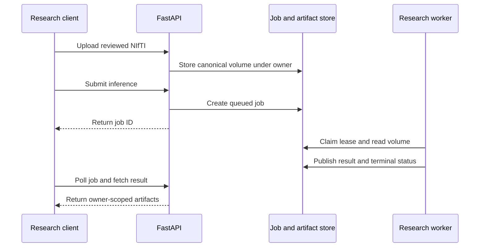
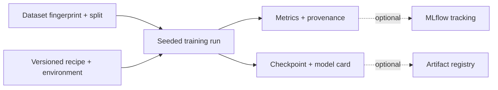
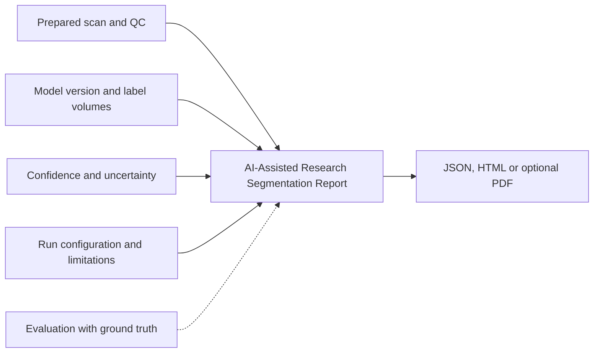
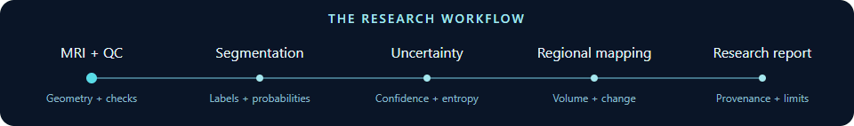

# NeuroVision-2028

**AI-Driven Precision Brain Segmentation & Mapping for MRI**

A reproducible workspace for preparing brain MRI, testing segmentation models, and interpreting research outputs.

[](https://github.com/manikantbindass/NeuroVision/actions/workflows/ci.yml)
[](https://github.com/manikantbindass/NeuroVision/actions/workflows/security.yml)
[](LICENSE)

> Research and educational use only. Not a medical device and not intended for clinical diagnosis or treatment.

[Quick start](#installation-and-quick-start) · [Synthetic demo](#synthetic-demo) · [Train and infer](#training-and-inference) · [Deployment](#deployment) · [Benchmarking](#benchmarking-and-evaluation)

### Platform at a glance

The browser can run the built-in phantom offline. In connected deployments, FastAPI accepts reviewed NIfTI and queues work. A separate worker retrieves jobs and publishes results through PostgreSQL. Redis coordinates request limits.



Start with the synthetic demo to explore slices, overlays and reports. Use the Python library to train or compare models. **Benchmark pending.**

## Why NeuroVision exists

Segmentation experiments depend on more than the network architecture. Voxel spacing, orientation, preprocessing, label definitions and scanner variation can all change a result. A mask alone leaves these decisions hidden and gives a reviewer little context for judging its reliability. NeuroVision connects the steps so researchers can compare experiments using explicit geometry, configuration, QC, and model provenance.

The Python library supports imaging, training, inference, evaluation and analysis. The React workspace provides an offline synthetic demo and an authenticated API workflow. The shipped API model catalog uses a synthetic threshold model to exercise the application. Trainable architectures and ensemble experiments run through the Python library.

## Architecture and AI pipeline



This is a reference workflow with optional branches. Python experiments compose the stages they need. The API exposes a bounded subset through separate job and result routes. See the [component contracts](docs/development/ARCHITECTURE.md) and [capability matrix](docs/development/CAPABILITIES.md).

### Preprocessing and QC

The imaging library produces canonical RAS+ volumes with affine and voxel spacing. Recipes can reorient, resample, crop or pad, normalize intensities, extract foreground, denoise, apply optional N4 bias correction and run seeded augmentation. Registration and skull stripping use adapters. Supply a reviewed transform or brain mask where required by the recipe. Steps record provenance, and QC checks geometry, blank or anomalous inputs, modality completeness, and available registration evidence. [Preprocessing and QC](docs/development/PREPROCESSING.md)

### Model zoo

| Family | Available models | Research use |
| --- | --- | --- |
| Convolutional | 2D U-Net, 3D U-Net, SegResNet | Compare slice-based and volume-based baselines. |
| Attention-gated convolutional | Attention U-Net | Test gating while retaining a convolutional backbone. |
| Transformer hybrids | UNETR, Swin UNETR | Compare tokenization and attention with convolutional alternatives under the same protocol. |

The factory, registry, checkpoint manager and tensor inference engine share explicit shape and class contracts. Parameters and supported operation counts can be reported. Runtime and memory depend on the input, checkpoint, device and inference settings. [Model zoo and comparison protocol](docs/research/MODEL_ZOO.md) · [Model card](MODEL_CARD.md)

### From a segmentation to a research result

| Feature | What it produces and how to read it |
| --- | --- |
| Ensemble intelligence | Uniform or weighted probability averaging, reversible flip TTA, and MC dropout on supported models. Members must agree on input alignment, channel order and class semantics. |
| NeuroConfidence | Voxel confidence, predictive entropy, ensemble variance and disagreement. Thresholds highlight review regions. Raw model scores are uncalibrated. |
| NeuroMap | Label counts, physical volumes, relative volume, confidence summaries and overlaps with an authorized atlas on a reviewed grid. Hemisphere comes from the region definition. |
| Explainability | Fixed-target gradient saliency and patch occlusion show sensitivity to the chosen input and target. They do not establish causality or clinical rationale. |
| NeuroTimeline | Registered mask differences and native regional volume change across research time points, with optional replicate spread. Acquisition, preprocessing, registration and model variation can all contribute to observed changes. |
| Research reporting | JSON and HTML exports plus optional PDF. Reports capture scan geometry, preprocessing, QC, model version, classes, volumes, confidence, limitations and reproducibility details. Evaluation requires ground truth. |

[Ensembles and uncertainty](docs/research/ENSEMBLE_INTELLIGENCE.md) · [Atlas mapping and attribution](docs/research/NEUROMAP.md) · [Longitudinal comparison](docs/research/NEUROTIMELINE.md) · [Report fields and exports](docs/research/REPORTING.md)

The [research novelty register](docs/research/NOVELTY.md) compares these concepts with prior work and records hypotheses, validation plans and current evidence.



Confidence and entropy describe the combined probabilities. Disagreement describes how members vote. A confident or unanimous result can still be wrong.

## Synthetic demo



Start the frontend and select **Start guided demo**. The built-in phantom exercises linked slices, class and opacity controls, uncertainty overlays, sampled 3D boundaries, and time-point comparison without uploading a scan. Connect a local API to try upload, preprocessing, inference, metrics, atlas mapping and report downloads. [Workspace guide](docs/development/WEB_WORKSPACE.md)

```bash
npm ci --prefix apps/web
npm run dev --prefix apps/web
```

Open the address printed by Vite. Use Node.js 22.12 or later. The offline viewer examples below write files to the ignored `artifacts/` directory.

```bash
python -m neurovision.uncertainty.example --output artifacts/neuroconfidence-synthetic
python -m neurovision.mapping.example --output artifacts/neuromap-synthetic/comparison.html
python -m neurovision.longitudinal.example --output artifacts/neurotimeline-synthetic/timeline.html
python -m neurovision.reporting.example --output artifacts/research-report-synthetic --pdf
```

## Installation and quick start

Install Git and Python 3.11 or later. These commands install the CPU research runtime and API extras. After activation, commands elsewhere in this README work with the virtual environment's `python`. The stage catalog alone needs only `python -m pip install .`.

### Bash terminal

```bash
git clone https://github.com/manikantbindass/NeuroVision.git
cd NeuroVision
python3 -m venv .venv
source .venv/bin/activate
python -m pip install --upgrade pip
python -m pip install --no-deps "torch>=2.8,<3" --index-url https://download.pytorch.org/whl/cpu
python -m pip install ".[imaging,preprocessing,training,api,pdf]"
python -m neurovision
```

### Windows PowerShell

```powershell
git clone https://github.com/manikantbindass/NeuroVision.git
Set-Location NeuroVision
py -3 -m venv .venv
.\.venv\Scripts\Activate.ps1
python -m pip install --upgrade pip
python -m pip install --no-deps "torch>=2.8,<3" --index-url https://download.pytorch.org/whl/cpu
python -m pip install ".[imaging,preprocessing,training,api,pdf]"
python -m neurovision
```

If PowerShell activation is restricted, invoke `.\.venv\Scripts\python.exe` in place of `python`.

### Windows Command Prompt

```bat
git clone https://github.com/manikantbindass/NeuroVision.git
cd NeuroVision
py -3 -m venv .venv
call .venv\Scripts\activate.bat
python -m pip install --upgrade pip
python -m pip install --no-deps "torch>=2.8,<3" --index-url https://download.pytorch.org/whl/cpu
python -m pip install ".[imaging,preprocessing,training,api,pdf]"
python -m neurovision
```

The CLI lists the pipeline stages. Add `bias` for optional SimpleITK N4, `zoo` for advanced MONAI models, or `mlops` for MLflow tracking. For the full test environment use the [quality gates](docs/development/QUALITY.md).

## Training and inference

Run reproducible synthetic experiments with the checked-in recipes. The trainer records validation metrics, saves checkpoints, and supports combined Dice/cross-entropy loss, early stopping, scheduling and mixed precision where supported.

```bash
python -m neurovision.training.example --config configs/baseline-2d.json --output artifacts/baseline-2d
python -m neurovision.training.example --config configs/baseline-3d.json --output artifacts/baseline-3d
```

For Python inference, reconstruct a trusted local model checkpoint and supply an aligned tensor with the recorded channel order. The zero tensor below is a shape smoke example.

```python
from pathlib import Path

import torch

from neurovision.inference.engine import InferenceEngine
from neurovision.models.checkpoints import CheckpointManager

model = CheckpointManager.load_model(Path("artifacts/baseline-3d/best.pt"))
prediction = InferenceEngine(model).predict(torch.zeros(1, 1, 32, 32, 32))
print(prediction.labels.shape)
```

[Baseline recipes and metrics](docs/development/BASELINE_TRAINING.md) · [Inference and sliding windows](docs/research/MODEL_ZOO.md#inference-and-checkpoint-identity)

## API and frontend

Set a disposable local bearer token in the same shell that starts the API. Use `export NEUROVISION_API_TOKEN=<token>` in Bash, `$env:NEUROVISION_API_TOKEN = '<token>'` in PowerShell, or `set "NEUROVISION_API_TOKEN=<token>"` in CMD. Replace the placeholder with a securely generated ASCII token of at least 32 characters.

```bash
python -m uvicorn apps.api.main:create_app --factory --host 127.0.0.1 --port 8000 --no-access-log
```

Open [local OpenAPI docs](http://127.0.0.1:8000/docs). In the web app, enter the token under **System / Models**. The API accepts reviewed NIfTI, queues preprocessing, inference, metrics, maps and reports, and serves owner-scoped results and exports. Poll `/api/v1/jobs/{id}` for completion. Public probes are `/api/v1/health` and `/api/v1/ready`. [Routes and upload contract](docs/api/README.md)



## Deployment

- **Docker Compose** provisions the frontend, API, inference worker, PostgreSQL and Redis. Generate local secrets and start the stack.

  ```bash
  python scripts/create_local_secrets.py
  docker compose up --build -d
  python scripts/check_compose.py
  ```

  Open [the Compose workspace](http://127.0.0.1:8080). The smoke script runs synthetic inference through the frontend proxy and separate worker.

- **Kubernetes and Helm** use the chart in `deployment/helm/neurovision` or the reference manifests in `deployment/kubernetes`. Configure image references, external PostgreSQL and Redis, secret mounts, TLS ingress and network policies. CPU autoscaling and a GPU worker profile are optional.
- **AWS architecture** is optional Terraform for private EKS CPU and GPU node groups, RDS PostgreSQL, Redis and private S3. Configure an ingress controller and monitoring in the target environment. Runtime artifacts currently reside in PostgreSQL. **Planned.** An S3 storage adapter.

[Deployment guide](docs/deployment/README.md) · [Private observability](docs/deployment/README.md#private-observability)

## Datasets

The local loader accepts scalar 3D NIfTI and a restricted subset of previously reviewed DICOM MRI. The API accepts NIfTI only. Explicit modality metadata covers T1, T1ce, T2 and FLAIR. Multimodal experiments require aligned channels and a declared order. The local BraTS adapter expects authorized data already on disk. Tests generate synthetic images and labels. [Data card](DATA_CARD.md) · [Ingestion and manifests](docs/development/IMAGING.md)

## Benchmarking and evaluation

**Benchmark pending.** Synthetic tests check expected behavior and provide reproducible demos. They do not estimate real MRI accuracy or establish model superiority.

[Scientific integrity and evidence requirements](docs/research/SCIENTIFIC_INTEGRITY.md)

| Question | Measurements |
| --- | --- |
| How closely do regions overlap? | Dice and IoU per class |
| Which errors dominate? | Precision, sensitivity/recall and specificity where appropriate |
| How far apart are the boundaries? | Hausdorff distance, HD95 and average symmetric surface distance in physical units |
| What resources does the model use? | Parameter count, supported operation counts, measured latency and peak memory on declared hardware |

For a benchmark, record dataset version, patient-level splits, preprocessing, class definitions, empty-mask handling, seed, hardware and software versions. Use an independent test set and evaluate model scores for calibration before interpreting confidence probabilistically. [Metric conventions](docs/development/BASELINE_TRAINING.md#metric-conventions)

## Reproducibility and MLOps

Versioned recipes and explicit seeds support synthetic replay. Artifacts can record dataset and configuration fingerprints, preprocessing, hyperparameters, metrics, Git revision and environment versions. Optional MLflow tracking and registry adapters capture runs and version artifacts. The DVC-compatible synthetic workflow demonstrates data versioning without redistributing restricted scans. [MLOps guide](docs/development/MLOPS.md)



## Security, privacy and ethics

Use synthetic data in development, CI and issue reports. Keep real patient data, identifiers, credentials, raw scans and private model artifacts out of Git. Review DICOM tags, private elements, burned-in text and recognizable anatomy before import. NIfTI voxels and derivatives can still expose sensitive information after header removal. Follow approved access, retention and deletion policies. Clinical suitability, fairness across populations and robustness across scanners have yet to be established.

The platform adds authenticated owner isolation, bounded uploads and decoding, no-store responses, privacy-conscious audit events, health checks and private metrics. CI scans dependencies and Git history. For multi-user deployments, integrate an approved identity provider through the authentication adapter. [Security policy](SECURITY.md) · [Threat model](docs/architecture/THREAT_MODEL.md) · [Quality gates](docs/development/QUALITY.md)

## Technology and repository structure

| Layer | Stack and location |
| --- | --- |
| Imaging and learning | Python, NiBabel, pydicom, NumPy, SciPy, optional SimpleITK, PyTorch and MONAI in `neurovision/` |
| API and web | FastAPI, Pydantic, React, TypeScript and Vite in `apps/` |
| Reproducibility | MLflow, DVC workflow and recipes in `neurovision/mlops/` and `configs/` |
| Runtime and observability | PostgreSQL, Redis, Docker, Kubernetes, Helm, Terraform and Prometheus in `deployment/` |
| Verification and docs | Python unittest, Playwright, Ruff, mypy and GitHub Actions in `tests/`, `.github/` and `docs/` |

[Repository map](docs/architecture/REPOSITORY.md)

## Limitations and roadmap

**Planned.** Priorities include independent multi-site MRI benchmarks, calibration studies, scanner and subgroup robustness, managed identity and artifact storage integrations, and validation on live cloud and GPU infrastructure. Registration quality and atlas alignment need review. Longitudinal differences can reflect acquisition or pipeline variation. The 3D preview samples boundary voxels. The capability matrix distinguishes implemented paths from experimental or future work. [Phase status](docs/development/PHASE_STATUS.md) · [Capability roadmap](docs/development/CAPABILITIES.md) · [Changelog](CHANGELOG.md)

## Contributing, citation and license

Use synthetic fixtures and run the applicable quality checks before opening a PR. Cite NeuroVision-2028 and include the exact revision used in research. The project is licensed under MIT. Dataset and checkpoint terms apply separately. [Contributing guide](CONTRIBUTING.md) · [Citation metadata](CITATION.cff) · [License](LICENSE)

The repository is maintained by [manikantbindass](https://github.com/manikantbindass) and [NeuroVision contributors](https://github.com/manikantbindass/NeuroVision/graphs/contributors). Thanks to the imaging, ML and open-source communities behind NiBabel, pydicom, PyTorch, MONAI, FastAPI and React.

### Continuous integration

Pull requests run Python formatting, lint, type checks, CPU model and API tests, frontend lint and build, browser tests, and a synthetic Compose workflow. Deployment checks validate Helm and Terraform. Security checks scan dependencies and Git history and reject common medical image extensions from the index. The documentation job checks local README links, diagram SVGs and animation placement. GPU training is outside the pull request workflow. [CI workflow](.github/workflows/ci.yml) · [Deployment checks](.github/workflows/deployment.yml) · [Security checks](.github/workflows/security.yml)

### What a research run leaves behind

Use the report to trace measurements back to the prepared scan and model. Ground-truth metrics appear only when a reference segmentation is available.



[Report fields and exports](docs/research/REPORTING.md) · [Run the synthetic demo](#synthetic-demo)


