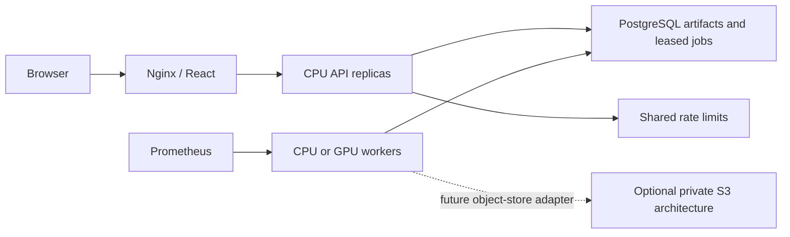

# Local and cloud deployment

> Research and educational use only. Not a medical device and not intended for clinical diagnosis or treatment.

The distributed service uses PostgreSQL for owner-scoped artifact blobs, job metadata, and worker leases. Redis provides shared rate limits. Nginx serves the web build and proxies the API. A separate worker executes queued research operations. The default model remains the synthetic fixture. Enable research weights through a reviewed application factory before using a task-specific model.



## Local Docker Compose

Use Docker Engine in Linux-container mode and Docker Compose v2. Run from the repository root.

```sh
python scripts/create_local_secrets.py
docker compose config --quiet
docker compose up --build -d
docker compose ps
```

Open [the local workspace](http://127.0.0.1:8080/). Read the generated `.secrets/api_token` locally and use it in System / Models to connect. The API endpoint is on the same origin. The helper creates random development credentials and refuses to overwrite an existing directory. Keep the directory private and excluded from Git.

The services are `web`, `api`, `worker`, `postgres`, `redis`, and the one-shot `schema` initializer. The CLI remains available through `docker compose --profile cli run --build --rm pipeline`. The optional `monitoring` profile adds Prometheus on loopback port 9090. Worker metrics expose activity and shared queue counts without subject or artifact labels.

The application containers use non-root users, read-only filesystems, temporary scratch space, dropped capabilities and resource limits. PostgreSQL keeps durable state in the named volume. Redis stores short-lived rate counters only. The Compose Redis instance is isolated on an internal development network and uses no password. Cloud connections require an access-controlled service and TLS credentials.

Use `docker compose down` to stop the stack. Database state remains in its volume. Running out of artifact quota returns an error. Remove obsolete scans and terminal jobs through their API routes to release logical quota. Database maintenance and physical disk reclamation require operator policy.

## Queue and storage behavior

The SQL schema initializer runs once before the local application. In Kubernetes, Helm runs it as a pre-install/pre-upgrade job. It creates schema version 1 and leaves existing data intact. Future schema migrations require a reviewed migration.

API replicas share job state, artifact ownership and admission quotas. Workers claim one job at a time with a 60-second database-clock lease, renewed every 15 seconds. An expired worker cannot publish its result. If a process dies after publishing but before updating job status, a later claim recognizes the saved result and completes the job. A crashed attempt can be retried up to three times. Input validation failures become terminal failed jobs.

This is at-least-once execution with fenced result publication. Model computation can repeat after worker loss. All job kinds share the same queue. Graceful shutdown stops claims and allows the current operation to finish. Kubernetes provides a 120-second shutdown period. Longer interrupted jobs recover after the lease expires.

Artifacts use bounded JSON and NumPy array encoding with pickle disabled. Shared admission is serialized by a quota row. The default logical limits are 512 MiB of retained artifacts, 512 artifact entries, 32 active jobs and 512 retained job records. These defaults establish a bounded research deployment and require measured capacity planning for larger workloads. PostgreSQL bytea storage is implemented. S3 is an optional architecture target requiring an object-store adapter and retention design.

## Images and GPUs

`deployment/docker/api.Dockerfile` builds the API and worker application image. The worker overrides the command with `python -m apps.api.worker`. `deployment/docker/web.Dockerfile` builds the frontend and serves it through Nginx.

The default application build installs CPU PyTorch. For a GPU worker, build a separate image using a supported CUDA PyTorch wheel index through `TORCH_INDEX_URL`, configure `NEUROVISION_WORKER_DEVICE=cuda`, and validate inference on the actual GPU and driver combination. Keep API pods on CPU nodes. The worker rejects CUDA mode when CUDA is unavailable. No GPU benchmark has been performed.

## Kubernetes and Helm

The chart is under `deployment/helm/neurovision`. It expects managed or independently deployed PostgreSQL and Redis. Use a dedicated namespace and one NeuroVision release per namespace because the frontend proxies the stable `api` service name.

Prepare private credential files with a PostgreSQL URL, Redis URL and API token for the target environment. Use `postgresql+psycopg://` and a TLS-enabled `rediss://` URL for cloud Redis. URL-encode credential values when composing connection strings. For RDS, configure certificate verification using the RDS CA bundle in the application image or mounted configuration.

```sh
kubectl create namespace neurovision
kubectl -n neurovision create secret generic neurovision-runtime \
  --from-file=database-url=.secrets/cloud/database_url \
  --from-file=redis-url=.secrets/cloud/redis_url \
  --from-file=api-token=.secrets/cloud/api_token
helm lint deployment/helm/neurovision
helm upgrade --install neurovision deployment/helm/neurovision \
  --namespace neurovision \
  --set api.image=YOUR_REGISTRY/neurovision-api:REVIEWED_TAG \
  --set worker.image=YOUR_REGISTRY/neurovision-api:REVIEWED_TAG \
  --set web.image=YOUR_REGISTRY/neurovision-web:REVIEWED_TAG
```

Prefer image digests for reviewed deployments. Configure image pull secrets through chart values. The schema initializer needs DDL permissions. Provision a separate runtime database role with the required table permissions when adapting the initialization workflow for a managed environment.

For TLS ingress, install the chosen ingress controller, provide the certificate secret, set `ingress.enabled=true` and supply your host. An AWS Load Balancer Controller deployment requires its IAM permissions and ingress class/annotations. The chart provides ingress routing through the frontend, not the controller itself.

API pods use liveness, startup and dependency-aware readiness probes. Worker readiness reflects successful queue polling or lease renewal. Network policies restrict runtime traffic to the frontend/API path, database, Redis and DNS, with monitoring access on the worker port. Verify that the cluster's network plugin enforces these policies.

The reference YAML in `deployment/kubernetes/workspace.yaml` is rendered from the Helm chart with ingress and API autoscaling enabled. Customize image references, domain and secret references before applying it with `kubectl -n neurovision apply -k deployment/kubernetes`. Prefer Helm for upgrades because its schema-job hook handles replacement.

### Autoscaling

API CPU autoscaling is opt-in and needs Kubernetes Metrics Server. It defaults to two through four replicas with a scale-down stabilization window. Shared persistence and Redis rate limits allow requests to move between replicas.

Worker replicas are configured independently. Use queue depth, inference duration, GPU memory and observed utilization to select capacity. The worker metrics export shared queue counts, so aggregate duplicate queue gauges with `max`, not a sum across workers. A PostgreSQL/KEDA scaler can query queued jobs after independent validation. The repository does not install KEDA or an automatic GPU scaler.

GPU mode requests one `nvidia.com/gpu` per worker and tolerates the matching taint. Install the NVIDIA device plugin and select GPU nodes. Workers use a Recreate rollout to avoid requiring a spare GPU during upgrades. Use node autoscaling or an operator-managed capacity policy to supply GPU nodes. [Kubernetes GPU scheduling](https://kubernetes.io/docs/tasks/manage-gpus/scheduling-gpus/)

## Optional AWS Terraform architecture

`deployment/terraform/aws` describes a private EKS cluster, CPU managed node group, optional GPU node group, encrypted private RDS PostgreSQL, encrypted Redis replication group, and versioned private S3 bucket. It takes existing VPC and private subnet IDs. The cluster operator role is explicit. RDS manages its master password in Secrets Manager. Supply the Redis auth token through a sensitive Terraform variable.

```sh
terraform -chdir=deployment/terraform/aws init
terraform -chdir=deployment/terraform/aws validate
```

No apply is part of this phase. Applying the configuration provisions chargeable AWS resources. Review an environment-specific plan, region support and quotas first. Protect Terraform state with an encrypted access-controlled remote backend because sensitive values can appear in state. Private nodes need approved egress or VPC endpoints for registry, DNS, database and AWS control-plane access.

Connect from an authorized network to the private cluster. Bootstrap networking, Metrics Server, ingress/load-balancer controller and any GPU device plugin before deploying the chart. Populate Kubernetes credentials from approved secret management and rotate them under operational policy. S3 provisioning does not connect the current PostgreSQL artifact backend to S3. The storage interface is the extension point for that work. [EKS architecture](https://docs.aws.amazon.com/eks/latest/userguide/eks-architecture.html)

## Validation boundary

Local tests cover serialization, persisted API results across database handles, concurrent claims, stale-worker publication rejection, crash recovery and shared rate limits. Helm lint/render and Terraform format/schema validation are part of deployment checks. The local Docker engine was unavailable during authoring, so image execution, a live Kubernetes cluster, GPU scheduling and AWS deployment remain unverified here. CI includes container build and a synthetic request through the Compose worker stack.
