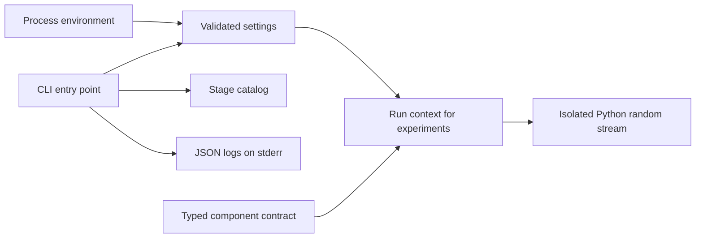
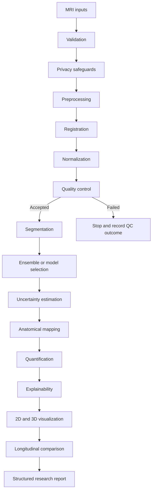

# NeuroVision Intelligence Pipeline

> Research and educational use only. Not a medical device and not intended for clinical diagnosis or treatment.

The [capability roadmap](CAPABILITIES.md) records the proposed stack and the validation required before enabling each feature.

## Foundation entry points

The CLI lists the catalog. Research callers construct the run context when executing an experiment. See the [foundation configuration](FOUNDATION.md) for the seed and logging contracts.

## Planned research workflow

The reference flow starts with an MRI volume and ends with a structured research report. The order below describes the workflow. Some stages also consume earlier artifacts, such as explainability consuming both the prepared image and a model prediction. Benchmarking can run multiple segmentation components against the same prepared inputs.

| Stage | Planned responsibility |
| --- | --- |
| Validation | Check format, dimensions, spatial metadata and input limits before processing. |
| De-identification safeguards | Check privacy policy at ingestion and reject or quarantine suspect inputs before downstream storage or logging. |
| Preprocessing | Prepare volumes and preserve the metadata needed to map results back to their source space. |
| Registration | Align volumes to a reference and record transforms and coordinate spaces. |
| Normalization | Apply a reproducible intensity transformation and record its parameters. |
| Quality control | Record imaging checks and block inputs that fail the experiment's acceptance criteria. |
| Segmentation | Produce model-specific predictions in a declared coordinate space and label schema. |
| Ensemble or model selection | Combine or select predictions and record the rule and model versions. |
| Uncertainty estimation | Produce estimates with the method, assumptions and settings attached. |
| Anatomical mapping | Map predictions to a declared atlas or anatomical reference. |
| Quantification | Calculate region measurements with explicit units, spacing and label definitions. |
| Explainability | Produce method-specific attribution artifacts linked to the model and inputs. |
| 2D and 3D visualization | Prepare overlays and views while preserving orientation and label identity. |
| Longitudinal comparison | Compare aligned time points and account for changes in acquisition and processing. |
| Structured research report | Assemble measurements, QC outcomes, uncertainty and experiment provenance. |

`PipelineComponent[StageInput, StageOutput]` defines the replacement boundary. Each component declares a stage and implements `run(inputs, *, context)`. Implementations for the same stage can be swapped when they accept the same inputs and preserve the same output semantics. `RunContext` carries an experiment identifier independent of subjects and a seed. Components that use randomness are responsible for applying the seed and documenting sources of nondeterminism.

Future stage implementations should define concrete artifact contracts before joining a workflow. MRI artifacts should carry axis and coordinate conventions, spacing, transforms, and label schema where applicable. Experiment records should capture configuration, software and model versions, and QC outcomes. API and web layers should consume these artifacts and show the research notice on relevant screens and exports.

The [local ingestion library](IMAGING.md) produces a canonical MRI volume after validation and orientation handling. Its DICOM boundary requires trusted prior review of identifiers in filenames, metadata and pixels. Tests and demos use synthetic data. The stage catalog CLI has no image input.

The [preprocessing stage](PREPROCESSING.md) implements the shared component contract for one canonical MRI volume. Its ordered transforms return a processed volume, geometry and seed provenance, and a QC report. Case-level QC checks modality completeness before per-volume processing.

The [baseline training module](BASELINE_TRAINING.md) consumes aligned volumes or slices and explicit labels. The training runner keeps validation separate, writes local checkpoints, and uses the evaluation module for overlap and physical surface metrics.

The [model zoo](../research/MODEL_ZOO.md) extends the training path with an explicit factory and registry. Native and MONAI models share a tensor input contract and output same-grid logits. The checkpoint manager records the architecture definition for reconstruction, and the inference engine handles evaluation precision and optional sliding windows.
