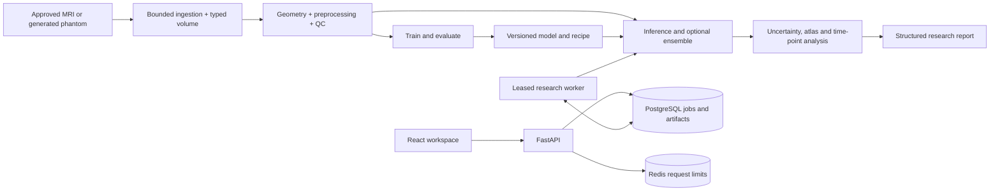

# NeuroVision-2028 architecture and phase acceptance plan

> Research and educational use only. Not a medical device and not intended for clinical diagnosis or treatment.

## Starting point

The repository already contains an unmerged stack through Phase 15. Phase 1 was implemented at `f4c9c343f603ab42ad97dcbde67a6924c5243eec` on `phase/01-foundation`. Its review is [PR #4](https://github.com/manikantbindass/NeuroVision/pull/4). The later integrated candidate was audited at `ac1005a`; the Phase 15 branch subsequently added evidence documentation. [Independent verification matrix](https://github.com/manikantbindass/NeuroVision/blob/a20ed29/docs/development/FINAL_AUDIT.md)

The Phase 1 checkpoint reviews the foundation in isolation. Existing later branches, uncommitted local deliverables, and Git history are preserved. Stop at each acceptance gate and wait for explicit approval before moving to the next phase. Integration requires green checks on the exact review head and resolution of applicable blockers.

## Proposed final architecture

Keep the standard-library core independent of imaging, ML and services. Geometry and categorical-versus-intensity semantics belong in the imaging and transform contracts. Share tensor conversion between training and serving. Attach dataset, configuration, checkpoint and environment identity to outputs. Separate the synthetic application demo from real MRI model evidence.

## Prerequisites and execution environments

| Scope | Requirements |
| --- | --- |
| Phase 1 locally | Git, Python 3.11+, pip, and a writable project directory. The CLI has no runtime dependencies. Development checks use the pinned Ruff, mypy and pre-commit extras. Docker is optional for the local CLI and required for the container smoke check. |
| Later phases on CPU | Python research extras and a CPU PyTorch wheel. Use Node.js 22.12+ for the web workspace and Chromium for browser tests. A Linux-capable Docker engine is required for a full local Compose run. Use synthetic data by default. |
| GPU experiments | Use a compatible GPU, driver, PyTorch CUDA build and container/device integration where applicable. Measure memory for the actual model, volume, patch size, precision and batch size before selecting capacity. The foundation, synthetic smoke tests and browser demo require no GPU. |
| Cluster or cloud | Kubernetes, Helm, network policies, TLS ingress, private PostgreSQL and Redis, and secret management. AWS Terraform is optional. Live cluster behavior and GPU execution require target infrastructure. **Planned.** S3 runtime artifact adapter and external identity integration. |

## Data candidates and access boundaries

| Data | Appropriate use and access |
| --- | --- |
| Generated NeuroVision phantoms | Default for CI, demos and deterministic regression. No external data agreement is needed. Synthetic results do not establish real MRI performance. |
| OpenNeuro ds000030 v1.0.0 | The deposited metadata declares CC0 and lists T1-weighted anatomy. Candidate for reviewed local NIfTI ingestion and geometry checks. Confirm the exact snapshot, source attribution and suitability of any derivative before use. It is not assumed to provide task-specific segmentation ground truth. [Dataset metadata](https://raw.githubusercontent.com/OpenNeuroDatasets/ds000030/master/dataset_description.json) |
| BraTS 2021 Task 1 | Candidate for an authorized local tumour segmentation study. The challenge instructions describe registration and access through Synapse. Confirm the current terms and approved use with the provider before obtaining or redistributing data. The adapter does not grant access. [Official challenge](https://www.med.upenn.edu/cbica/brats2021/) |

No data was downloaded or approved for this checkpoint. Stage authorized data outside Git. Review privacy risks in metadata, recognizable anatomy and derived outputs even when source data is public.

## Technical and research risks

- Mask interpolation can invent class IDs. Preserve categorical semantics and require nearest-neighbor sampling for labels.
- Training and API model axis order differ in the audited candidate. Share the forward and inverse conversion and test a directional noncubic phantom.
- Duplicate scan content can cross manifest splits. Audit subject group keys and exact content before reporting performance.
- Oblique geometry, registration errors, acquisition shifts and uncalibrated scores can mislead interpretation. Use geometry-aware checks, human review and explicit limitations.
- Keep the deployed synthetic fixture distinct from trained research checkpoints. Validate ownership, rate limits, leases, retention and secret handling before wider access.
- **Benchmark pending.** Synthetic results verify software behavior. Real MRI claims require authorized data, a subject-disjoint holdout, documented methods and reproducible measured results.

## Phase acceptance gates

| Phase | Acceptance criteria |
| --- | --- |
| 1. Foundation | Clean isolated install, CLI startup outside the source tree, settings and structured logging tests, deterministic seed and stage contracts, lint, formatting, strict types, documented setup and scoped container check. |
| 2. Data engine | Valid and malformed NIfTI fixtures, bounded decoding, affine and spacing verification, reviewed local DICOM fixtures and privacy rejection, safe paths, and documented dataset terms. Before benchmarking, prove content and subject groups do not cross splits. |
| 3. Preprocessing and QC | Synthetic geometry and provenance checks, cache determinism, failure handling, and categorical resample and registration tests that preserve class IDs. |
| 4. Baseline segmentation | Synthetic 2D and 3D shape, training, loss, metric and checkpoint replay tests. Record class and spacing conventions. |
| 5. Model zoo and inference | Exercise registered model shapes, checkpoint compatibility and precision/device behavior. Test anisotropic input and an explicit reversible training-to-inference axis contract. |
| 6. Ensemble and uncertainty | Compare weighted reductions with analytic expected outputs, verify inverse TTA and seeded dropout, and label uncertainty as uncalibrated until validated. |
| 7. Explainability and NeuroMap | Verify target sensitivity, atlas coverage, laterality, nearest-neighbor labels and physical volumes with controlled fixtures. Review external transforms and atlas terms. |
| 8. NeuroTimeline | Verify known change, shared coverage, zero baseline and paired replicate cases. Document registration, sampling and acquisition limitations. |
| 9. Backend | Verify bounded uploads, owner isolation, error schema, asynchronous job status and durable worker behavior. Regress training-to-serving axis order. |
| 10. Frontend | Build and test desktop/mobile synthetic and connected flows, accessible controls, oblique plane labelling, larger scan lists and recovery after rate limiting. |
| 11. Reporting | Verify reproducibility fields, missing-reference handling, escaping, integrity and JSON, HTML and PDF exports. |
| 12. MLOps | Replay a synthetic experiment, verify dataset and model fingerprints, checkpoint resume, registry behavior and the DVC-compatible workflow. |
| 13. Deployment | Build Linux images, run the Compose smoke through the worker, validate Helm, manifests and Terraform. Record live-cluster, GPU or cloud checks separately. |
| 14. Hardening and QA | Pass secret, dependency and static scans, bounded-upload and owner-isolation regressions, telemetry checks, and Python and browser CI. |
| 15. Documentation and release | Verify installation commands, links, banners, screenshots, PPT and PDF, model and data cards, novelty register and final audit. Resolve release blockers and check current CI before merge or publication. |

## Phase 1 boundary

The acceptance target is a clean, dependency-light foundation. MRI parsing, preprocessing, inference, datasets and web integration are outside this checkpoint. Do not start Phase 2 until the user approves the checkpoint.
